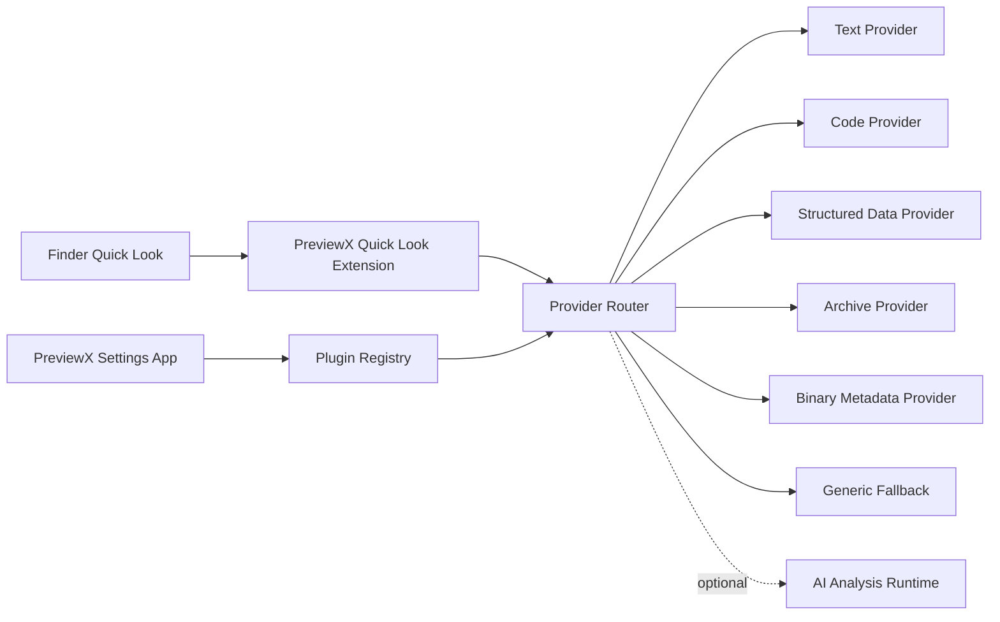

# PreviewX — Project Vision

## 1. Document Status

- Status: Proposed / implementation-ready baseline
- Audience: Product owner, macOS engineers, AI coding agents, plugin authors, QA
- Platform: macOS
- Primary interaction: Finder → select file → Spacebar → Quick Look
- Product principle: **Preview first, open later.**

## 2. Vision

PreviewX is a developer-oriented file preview platform for macOS. It extends the system Quick Look experience with a consistent rendering layer for source code, configuration, logs, structured data, archives, databases, binary metadata, and other developer artifacts.

The product is not merely a collection of Quick Look generators. It is a platform with:

1. A native macOS shell and settings application.
2. A Quick Look Preview Extension.
3. A safe, extensible preview-engine runtime.
4. A declarative plugin format.
5. Built-in preview providers.
6. An optional AI analysis layer.
7. A test corpus and conformance suite.
8. An SDK for third-party providers.
9. A deterministic fallback strategy when no specialized renderer exists.

Apple's Quick Look system already previews many standard types, and custom formats can be supported with a Quick Look Preview Extension whose supported content types are declared in the extension. PreviewX therefore treats the Apple extension boundary as the OS integration layer and keeps the internal provider system independent from that boundary. citeturn0search0turn0search9

## 3. Product Promise

For a developer, the expected workflow is:

```text
Find a file
   ↓
Press Space
   ↓
PreviewX identifies the file
   ↓
Selects the safest/highest-priority provider
   ↓
Renders useful content immediately
   ↓
Optionally exposes search, metadata, structure, and AI actions
```

The preview must be useful even when the file is incomplete, malformed, huge, encrypted, generated by a new tool, or has an unknown extension.

## 4. Goals

### P0

- Excellent Finder Spacebar preview experience.
- Fast preview for text, source code, configuration, logs, JSON/YAML/TOML/XML, Markdown, CSV, and common archives.
- Deterministic provider selection.
- No network access required for basic previewing.
- Strong resource limits and crash isolation.
- Clear unsupported/error states.
- Installable and maintainable as a normal macOS application.

### P1

- SQLite/database preview.
- Binary metadata preview.
- Archive tree preview with safe inspection.
- Image/video/audio metadata.
- Search and line navigation.
- Preview history and diagnostics.
- Plugin SDK.

### P2

- AI-assisted analysis.
- Local-model support.
- Remote-model providers.
- Community plugin catalog.
- Cross-application integration.
- CLI tooling.

## 5. Non-Goals

- Replacing Finder.
- Becoming a full IDE.
- Editing source files inside Quick Look.
- Executing arbitrary scripts contained in files.
- Automatically extracting untrusted archives to user-visible locations.
- Sending file contents to cloud AI without explicit consent.

## 6. Core Principles

1. **Local-first.**
2. **Read-only by default.**
3. **Never execute file content merely to preview it.**
4. **Provider isolation.**
5. **Deterministic behavior.**
6. **Fast path before feature richness.**
7. **Graceful degradation.**
8. **Privacy by default.**
9. **Observable failures.**
10. **Stable plugin contracts.**

## 7. Architecture Principle

The key architectural decision is to separate:

- OS integration: Quick Look Extension
- Provider orchestration: Preview Runtime
- Parsing/rendering: Providers
- UI primitives: Preview UI Kit
- optional analysis: AI Runtime
- plugin lifecycle: Plugin Manager

The Quick Look extension should remain thin. Heavy or risky parsing should be delegated to controlled components rather than turning the extension itself into a monolith.

## 8. Success Metrics

| Metric | MVP target |
|---|---:|
| Cold text preview | < 300 ms for 1 MB |
| Warm text preview | < 100 ms |
| 10 MB source preview | < 1 s |
| 100 MB log initial viewport | < 2 s |
| Main-thread blocking | 0 sustained blocking operations |
| Provider crash rate | < 0.1% preview attempts |
| Unsupported-file explanation | 100% of failures |
| Network use during normal preview | 0 |

## 9. Definition of Done

PreviewX is MVP-complete when a fresh macOS installation can:

1. Install PreviewX.
2. Select supported developer files in Finder.
3. Press Space.
4. Receive a useful preview without opening another application.
5. Search or navigate when supported.
6. Preview malformed input without crashing Finder.
7. Disable individual providers.
8. Produce diagnostics for failed previews.
9. Run entirely offline for P0 functionality.

## 10. Mermaid Overview


