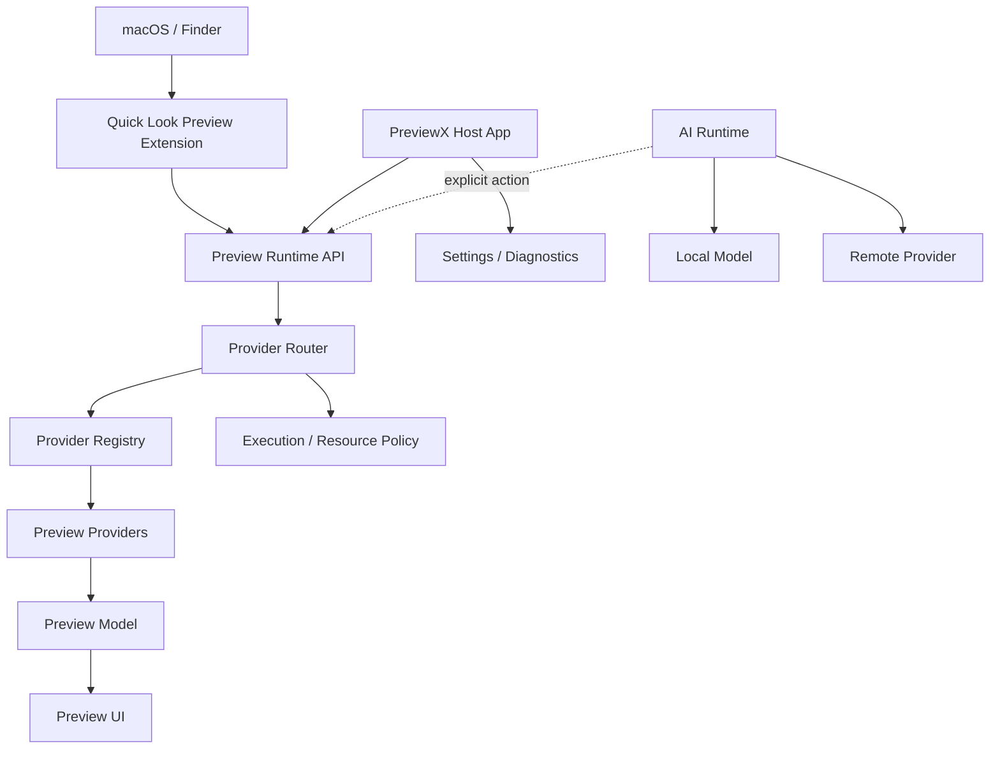
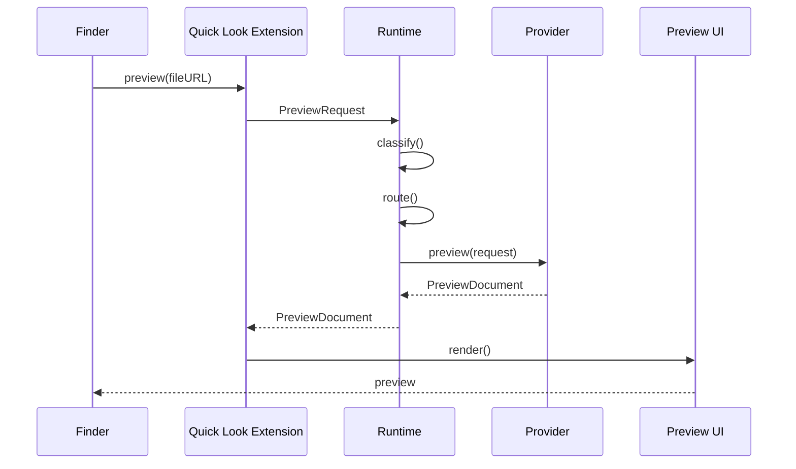

# PreviewX — System Architecture

## 1. Architectural Model

PreviewX uses a layered architecture:



## 2. Process Boundaries

The Quick Look extension is an OS-managed extension and should be treated as a constrained execution environment.

The architecture must not assume that arbitrary dynamic code can simply be loaded into the extension at runtime. Instead, the first-party provider set is compiled into the extension or into components explicitly supported by the extension architecture. Third-party extensibility is therefore designed as an install-time integration mechanism, not as "download a random executable and load it into Quick Look."

## 3. Components

### PreviewXApp

Responsibilities:
- settings
- provider enable/disable
- diagnostics
- plugin installation
- cache inspection
- AI configuration
- update management

### PreviewXQuickLook

Responsibilities:
- receive preview request
- create runtime context
- invoke router
- render result
- enforce timeout/cancellation
- report diagnostics

### PreviewRuntime

Responsibilities:
- classification
- provider routing
- resource policy
- parser lifecycle
- preview model generation

### Provider

Responsibilities:
- recognize supported input
- parse safely
- emit PreviewDocument
- never mutate the original file

### UI Kit

Responsibilities:
- text renderer
- syntax renderer
- tree renderer
- metadata cards
- table renderer
- error state
- toolbar

## 4. Data Flow



## 5. PreviewDocument

The internal canonical representation must be renderer-neutral.

```swift
struct PreviewDocument {
    let title: String
    let subtitle: String?
    let blocks: [PreviewBlock]
    let metadata: [MetadataItem]
    let capabilities: Set<PreviewCapability>
    let warnings: [PreviewWarning]
}
```

The document should support:
- text
- code
- tree
- table
- image
- metadata
- error
- attachments

## 6. Provider Router

Routing order:

1. exact UTType match
2. exact extension match
3. content signature
4. generic type conformity
5. fallback

Tie-breaking:
- explicit user preference
- provider priority
- version
- built-in over third-party when equal
- deterministic provider ID

## 7. Caching

Cache keys:

```text
SHA256(file identity + size + modification date + provider version + renderer version)
```

Do not hash huge files synchronously on the critical path. Use a bounded identity strategy first and hash asynchronously when needed.

Cache must never be used as a trust boundary.

## 8. Failure Containment

A provider can return:
- success
- partial
- unsupported
- malformed
- resourceExceeded
- cancelled
- failed

The host converts each to a user-facing state.

## 9. Acceptance Criteria

- Components have explicit responsibilities.
- Quick Look integration is isolated.
- Providers do not access UI internals.
- UI does not parse source files.
- AI does not run automatically.
- Failure in one provider cannot invalidate unrelated providers.
