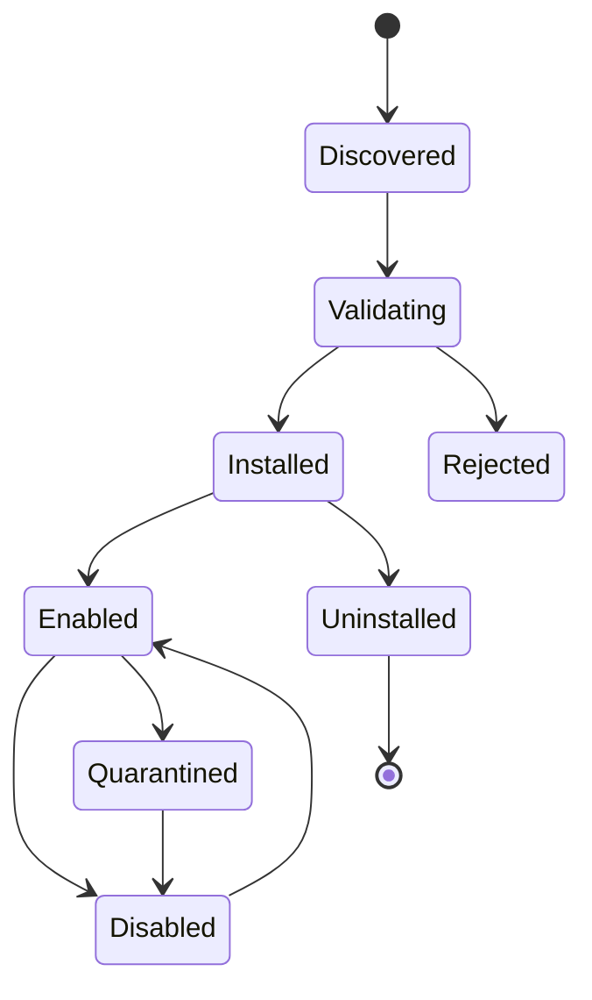

# PreviewX — Plugin System

## 1. Objective

Create an extensibility model that is powerful without pretending that the macOS Quick Look extension boundary is a general-purpose runtime plugin host.

## 2. Plugin Classes

### Built-in Provider

Compiled with PreviewX. Highest trust.

### Signed External Provider

Installed through PreviewX and packaged according to the PreviewX plugin contract.

### Declarative Plugin

Contains:
- manifest
- type mappings
- grammar configuration
- renderer configuration
- optional WASM/data-driven parser in future versions

### AI Provider

Implements analysis APIs and is never automatically invoked for preview generation.

## 3. Manifest

```json
{
  "schemaVersion": 1,
  "id": "com.previewx.provider.example",
  "name": "Example Provider",
  "version": "1.0.0",
  "minimumPreviewXVersion": "1.0.0",
  "supportedTypes": ["public.json"],
  "extensions": ["json"],
  "capabilities": ["tree", "search"],
  "trust": "signed"
}
```

## 4. Lifecycle



## 5. Validation

Before activation:
- schema validation
- ID validation
- version compatibility
- signature verification
- path validation
- supported-type validation
- declared permission validation

## 6. Routing

A plugin must never win routing solely because it has a broader wildcard declaration. Exact matches take precedence.

## 7. Plugin API

```swift
protocol PreviewXPlugin {
    var manifest: PluginManifest { get }
    func register(into registry: ProviderRegistry)
}
```

Third-party native code must not be loaded from arbitrary locations without an explicit security design and code-signing policy.

## 8. Failure

If a plugin repeatedly fails:
1. mark unhealthy;
2. disable for current session;
3. persist crash/failure metadata;
4. offer re-enable in settings;
5. never loop on repeated crashes.

## 9. Acceptance Criteria

- Bad manifests are rejected.
- Duplicate IDs are rejected.
- Unsupported schema versions are rejected.
- Plugin crashes do not crash the host.
- Disabled plugins cannot be selected.
- Routing remains deterministic.
