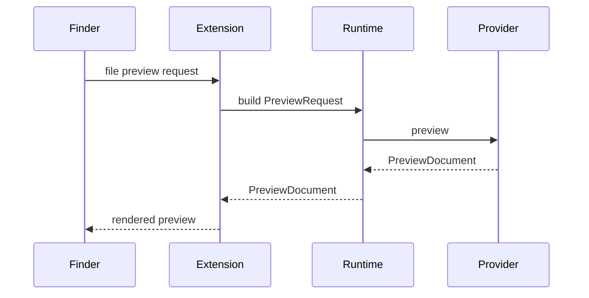

# PreviewX — Quick Look Extension

## 1. Purpose

This document defines the OS integration layer.

Apple's Quick Look documentation states that custom data formats can be handled by a Quick Look Preview Extension, either with a view-based controller or a data-based `QLPreviewProvider`. Supported content types are declared by the extension. citeturn0search0turn0search5

## 2. Extension Contract

The extension receives a file preview request and must produce a preview within the OS-managed lifecycle.

Recommended first implementation:
- view-based preview for rich interactive developer previews;
- data-based preview for deterministic HTML/PDF-style output where appropriate.

## 3. Content Type Registration

PreviewX must declare the content types it owns through `QLSupportedContentTypes` and appropriate Uniform Type Identifier declarations. Apple's documentation identifies UTType as the mechanism for describing file/data types and relationships. citeturn0search0turn0search4

## 4. Request Flow



## 5. Constraints

The extension must:
- avoid long synchronous work;
- support cancellation;
- avoid holding files open unnecessarily;
- avoid arbitrary subprocess execution;
- not assume network availability.

Apple explicitly advises preview controllers not to hold files open for the duration of a preview unless needed for interaction. citeturn0search8

## 6. Error UI

```text
Unable to preview this file

Reason: File exceeds preview budget.

Actions:
[Open with PreviewX]
[Show Diagnostics]
```

## 7. Acceptance

- Finder Spacebar launches PreviewX for supported types.
- Unsupported files fall back cleanly.
- Extension can be disabled without corrupting files.
- Cancellation releases resources.
