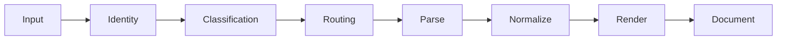

# PreviewX — Preview Engine

## 1. Pipeline



## 2. Classification

Inputs:
- URL
- UTType
- extension
- file size
- filesystem metadata
- optional bounded magic bytes

Output:

```swift
struct FileClassification {
    let contentType: UTType?
    let confidence: Double
    let evidence: [ClassificationEvidence]
}
```

## 3. Provider Selection

```swift
struct MatchScore {
    let confidence: Double
    let priority: Int
    let specificity: Int
}
```

Score components:
- UTType exact = 1000
- extension exact = 700
- signature = 800
- conforming type = 400
- generic fallback = 100

The final algorithm must be deterministic.

## 4. Preview Generation

Preview providers should generate an intermediate model rather than drawing directly wherever possible.

Benefits:
- testability
- multiple frontends
- accessibility
- AI analysis
- snapshot testing

## 5. Large Files

For text:
- map or stream only requested regions;
- create line index incrementally;
- cap syntax highlighting to visible ranges;
- avoid loading the entire file.

For archives:
- inspect central directory/index when available;
- cap entry count;
- do not extract all files.

## 6. Cancellation

Every async operation checks cancellation at:
- file read boundary;
- parser loop;
- rendering batch;
- archive entry loop.

## 7. Acceptance

- A 500 MB log can show an initial viewport without loading all bytes.
- Cancellation terminates parsing.
- Malformed input yields structured error.
