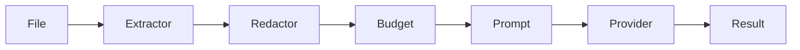

# PreviewX — AI Architecture

## 1. Principle

AI is an analysis layer, not a prerequisite for previewing.

## 2. Providers

```text
AIProvider
├── Apple/local model adapter
├── Ollama adapter
├── OpenAI-compatible adapter
├── Generic HTTP adapter
└── Future providers
```

The implementation must not hard-code one vendor.

## 3. Explicit Consent

Before remote analysis:
- show provider;
- show whether data leaves device;
- show data scope;
- allow cancellation;
- respect sensitive-file policy.

## 4. Data Model

```swift
struct AIAnalysisRequest {
    let fileID: FileIdentity
    let scope: AnalysisScope
    let prompt: String?
    let providerID: String
    let policy: AIPolicy
}
```

## 5. Context Extraction

Never send a huge file blindly.

Pipeline:



Possible extraction:
- selected lines
- current viewport
- log error clusters
- JSON subtree
- archive manifest
- metadata

## 6. Security

Sensitive content categories can be configured:
- environment files
- private keys
- credentials
- tokens
- secrets
- personal data

Default policy: block or redact likely secrets before remote transmission.

## 7. AI Features

P1:
- summarize
- explain
- classify error
- extract key configuration

P2:
- log root-cause hypotheses
- code explanation
- config migration suggestions
- archive manifest analysis

AI output must be labeled as analysis, not authoritative truth.

## 8. Acceptance

- Basic preview works with all AI disabled.
- Remote calls are visible in diagnostics.
- Cancellation works.
- Prompt/data scope is auditable.
