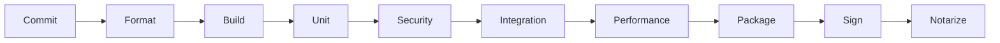

# PreviewX — Release Engineering

## 1. Branching

Recommended:
- `main`
- short-lived feature branches
- release branches only when needed

## 2. CI

Pipeline:

## 3. Build Artifacts

- PreviewX.app
- debug symbols where appropriate
- test reports
- benchmark reports
- release manifest

## 4. Reproducibility

Record:
- compiler version
- SDK version
- dependency lock state
- build configuration

## 5. Release Gates

No release if:
- Quick Look extension fails validation;
- critical security test fails;
- crash regression exceeds threshold;
- provider compatibility is broken.

## 6. Rollback

Maintain a known-good previous release and documented downgrade procedure.
